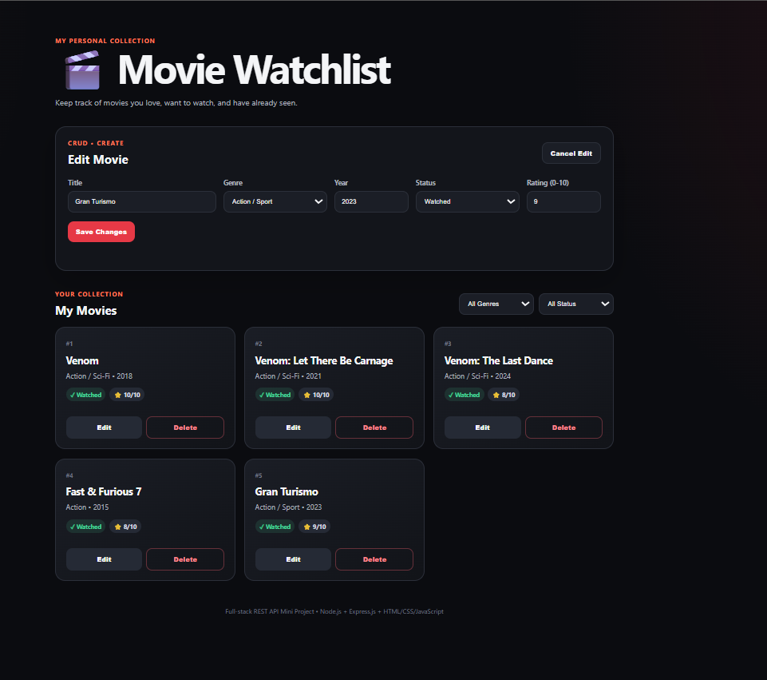
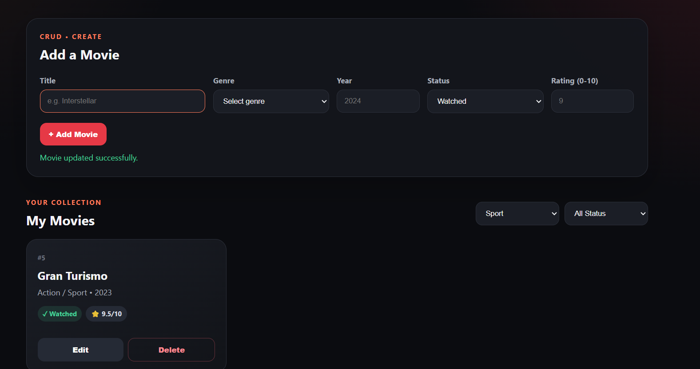

# 🎬 Movie Watchlist

Mini Project: Full-stack Web Application with REST API using **Node.js + Express.js + HTML/CSS/JavaScript**.

## 1. Project Description

Movie Watchlist is a small full-stack web application for managing a personal movie collection.

Users can:

- View all movies
- Filter movies by genre or status
- View a single movie by ID through the REST API
- Add a new movie
- Edit an existing movie
- Delete a movie
- Perform CRUD operations without reloading the page

The frontend communicates only with this project's own REST API.

## 2. Technologies

- Node.js
- Express.js
- HTML5
- CSS3
- JavaScript
- Fetch API

## 3. Project Structure

```text
movie-watchlist/
├── server/
│   └── server.js
├── public/
│   ├── index.html
│   ├── style.css
│   └── script.js
├── package.json
├── README.md
├── REPORT.pdf
└── .gitignore
```

## 4. Installation

Make sure Node.js is installed.

Open a terminal in the project folder and run:

```bash
npm install
```

## 5. Run the Project

Development mode:

```bash
npm run dev
```

Or normal mode:

```bash
npm start
```

Then open:

```text
http://localhost:3000
```

## 6. REST API Endpoints

| Method | Endpoint | Description | Success | Error |
|---|---|---|---|---|
| GET | `/api/movies` | Get all movies | 200 | - |
| GET | `/api/movies?genre=Sci-Fi` | Filter by genre | 200 | - |
| GET | `/api/movies?status=Watched` | Filter by status | 200 | - |
| GET | `/api/movies/:id` | Get one movie | 200 | 404 |
| POST | `/api/movies` | Add a movie | 201 | 400 |
| PATCH | `/api/movies/:id` | Update a movie | 200 | 400/404 |
| DELETE | `/api/movies/:id` | Delete a movie | 204 | 404 |

## 7. Example POST Request

```json
{
  "title": "Interstellar",
  "genre": "Sci-Fi",
  "year": 2014,
  "status": "Watched",
  "rating": 10
}
```

## 8. Data Validation

The API checks:

- Required fields: `title`, `genre`, `year`, `status`
- Valid year
- Rating between 0 and 10
- Status must be `Watched` or `Want to Watch`

Invalid data returns:

```text
400 Bad Request
```

## 9. Initial Movie Data

The application starts with these movies:

| Movie | Year | Genre | Status | Rating |
|---|---:|---|---|---:|
| Venom | 2018 | Action / Sci-Fi | Watched | 10/10 |
| Venom: Let There Be Carnage | 2021 | Action / Sci-Fi | Watched | 10/10 |
| Venom: The Last Dance | 2024 | Action / Sci-Fi | Watched | 8/10 |
| Fast & Furious 7 | 2015 | Action | Watched | 8/10 |
| Gran Turismo | 2023 | Action / Sport | Watched | 9/10 |

## 10. Frontend CRUD

The frontend uses `fetch()` to communicate with the REST API.

- GET → display movies
- POST → add a movie
- PATCH → edit a movie
- DELETE → remove a movie

All operations update the page without a full browser reload.

## 11. Debugging Screenshots

> **Important:** Add the two required debugging screenshots here before submission.
>
> Screenshot 1: API request/response in browser DevTools or Postman.
>
> Screenshot 2: Frontend showing the working Movie Watchlist and CRUD result.

Example locations:

```text
docs/screenshots/api-debug.png
docs/screenshots/frontend.png
```

## 12. Notes

This project uses an in-memory JavaScript array as its data store. No external API or external database is required by the assignment.

If the server is restarted, changes made during that session are reset to the initial movie data.

## 13. Submission

Upload the entire project as one GitHub repository, including:

- `server/`
- `public/`
- `package.json`
- `README.md`
- `REPORT.pdf`

No online hosting is required.
## Debugging Screenshots

### Screenshot 1 — Main Movie Watchlist
Shows the running application with the initial movie collection and CRUD controls.



### Screenshot 2 — Update + Query Filter
Shows a successful movie update message and the `Sport` genre query filter returning `Gran Turismo`.


